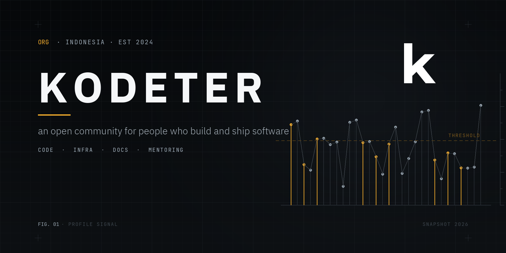

## About

Kodeter is a community of Indonesian builders: engineers, students, and the people who keep systems running for a living. We publish what normally stays in private folders. Small utilities, deployment notes, incident write-ups, and the explanations a senior colleague gives once and then never writes down.

Everything here is open. Repositories carry their own README, license, and issue tracker, and questions get answered in plain language.

## What lives here

| Kind | Contents |
|---|---|
| Tools | Small CLIs, scripts, and utilities we would otherwise rewrite every quarter |
| Infrastructure | Deployment templates, configuration, and runbooks |
| Notes | Post-mortems, architecture decisions, and reading lists |

## Get involved

- Open an issue before writing code. A short discussion costs less than a rewrite.
- Look for `good first issue` in the repositories that are easiest to start with.
- Ask in the repository's Discussions tab when it is unclear which project owns the problem.

## Code of conduct

Kodeter follows the Contributor Covenant. Read [the code of conduct](https://github.com/kodeter/.github/blob/main/CODE_OF_CONDUCT.md) before opening a pull request.

## Elsewhere

- Website: [kodeter.eu.org](https://kodeter.eu.org)
- Repositories: [github.com/kodeter](https://github.com/kodeter)
